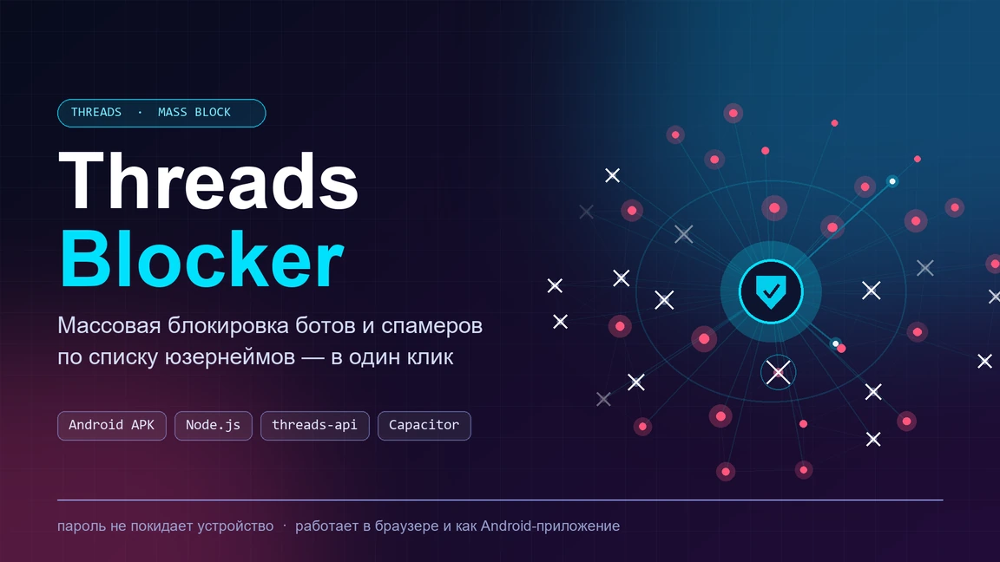

<p align="center">
  
</p>

# ThreadsBlocker

Массовая блокировка аккаунтов Threads по списку юзернеймов. Логин и пароль не уходят на сторонние серверы — запросы идут с вашего устройства напрямую в Instagram.

## Компьютер (браузерная версия)

Нужен только [Node.js](https://nodejs.org) (устанавливать пакеты не нужно):

```bash
git clone <URL-репозитория>
cd <папка>
node server.js
```

Откроется страница: войдите, вставьте юзернеймы (по одному на строку) или загрузите `.txt`, нажмите «Заблокировать всех».

## Телефон (Android-приложение)

<p align="center">
  <a href="https://github.com/infabls/ThreadsBlocker/releases/latest/download/ThreadsBlocker.apk">
    
  </a>
</p>

Автономное приложение, ничего больше не нужно: нажмите кнопку выше, откройте скачанный файл (включите «Установка из неизвестных источников») и установите. Все версии — в [Releases](https://github.com/infabls/ThreadsBlocker/releases).

Новый релиз собирается автоматически при создании тега: `git tag v1.0.1 && git push --tags`.

Сборка APK самому:

```bash
pnpm install        # или npm install
pnpm build          # собирает src/bundle.js (библиотека threads-api для браузера/webview)
pnpm exec cap sync
pnpm exec cap open android   # собрать APK в Android Studio
```

## Как устроено

- Вход и блокировка — через [threads-api](https://github.com/junhoyeo/threads-api); для браузера/webview она собирается в `src/bundle.js` (исходник — `lib/entry.js`).
- Браузер: `server.js` раздаёт `src/` и проксирует запросы на i.instagram.com (из страницы напрямую нельзя из-за CORS).
- Android: Capacitor, запросы идут нативно (`CapacitorHttp`), сессия хранится в `@capacitor/preferences`.
- Пауза между блокировками 500 мс; для списков больше 100 имён возможен временный rate-limit.
- Другой порт: `PORT=9000 node server.js`.
